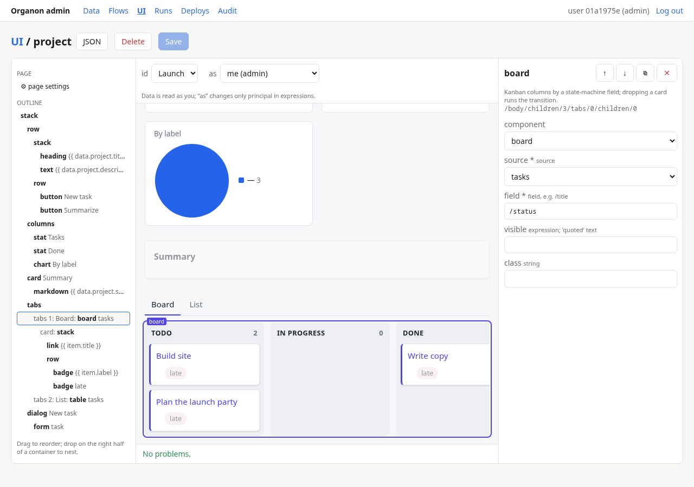

# 11. User interface

An app's end-user UI is a set of JSON files in `ui/`. `organond` serves it
at `/` with a built-in renderer, so there is nothing to build. You can write
the files by hand, or design pages in the admin console under **UI**, which
writes the same files. `organon validate` checks every page against your
types, policies, and flows, like it checks flows.

```
ui/
  app.json            # the shell: title, home page, navigation, login
  pages/<name>.json   # one page per file
  i18n/<lang>.json    # optional: translations, one file per language
  styles.css          # optional: your CSS, loaded after the base theme
  assets/**           # images and fonts, served at /assets/app/<path>
```

Modules may add pages in `modules/<name>/ui/pages/`. Page names must be
unique across the app.

## app.json

```json
{
  "title": "Tracker",
  "home": "projects",
  "requireLogin": true,
  "logo": "assets/logo.svg",
  "nav": [
    { "label": "Projects", "page": "projects" },
    { "label": "My tasks", "page": "myTasks", "visible": "principal.kind == 'user'" }
  ],
  "notFound": "This page does not exist.",
  "languages": ["en", "el"]
}
```

| Key | Meaning |
| --- | --- |
| `home` | The page shown at `/` when no page has the route `/`. Required. |
| `requireLogin` | Default `true`: anonymous visitors see the login screen (password, OIDC, MFA as configured in `app.json` `auth`). With `false`, anonymous visitors get the pages whose `visible` allows them. |
| `nav` | Header links. `visible` is an expression over `principal` only. |
| `logo` | A file in `ui/assets`, written as `assets/<path>`. |
| `linkHome` | The page a [share link](04-policies.md#share-links) opens, with `params.id` set to the shared feature. Give it `"visible": "principal.kind == 'link'"` (and other pages `"principal.kind != 'link'"`). Link holders never see the sign-in screen. |
| `languages` | The UI languages; the first is the language the ui/ files are written in. See [Languages](#languages). |

## A page

```json
{
  "page": "project",
  "title": "{{ data.project.title }}",
  "route": "/projects/:id",
  "params": { "id": { "type": "string", "format": "uuid" } },
  "data": {
    "project": { "feature": "params.id", "type": "project" },
    "tasks":   { "children": "params.id", "type": "task" }
  },
  "body": { "component": "stack", "children": [
    { "component": "heading", "text": "{{ data.project.title }}", "level": 1 },
    { "component": "button", "label": "Summarize", "visible": "can(data.project, 'action:summarize')",
      "on": { "click": [ { "do": "action", "type": "project", "id": "params.id", "action": "summarize" },
                         { "do": "toast", "text": "Risk: {{ result.output.risk }}" } ] } },
    { "component": "board", "source": "tasks", "field": "/status",
      "card": { "component": "link", "text": "{{ item.title }}", "page": "task", "params": { "id": "item.id" } } }
  ] }
}
```

| Key | Meaning |
| --- | --- |
| `page` | Unique name; links and `navigate` steps use it. |
| `route` | `/`, `/projects`, or with parameters `/projects/:id`. `/v1`, `/admin`, and `/assets` are reserved. |
| `params` | Every route parameter, plus optional query-string parameters: `{"type": "string" \| "integer" \| "number" \| "boolean"}`. |
| `visible` | Expression over `principal`; the page is not offered (or listed in the bundle) when false. |
| `state` | Page variables: `{"tab": {"type": "integer", "default": 0}}`. Change them with `set` steps. |
| `data` | Data sources, below. |
| `body` | The component tree. |
| `x-layout` | Builder hints; ignored when rendering. |

## Text and expressions

Every prop has a kind (see `organon ui catalog`). Two matter most:

- **Text** props (`text`, `label`, `title`, `empty`, ...) are literal text
  with `{{ expr }}` interpolations: `"Tasks of {{ data.project.title }}"`.
- **Expression** props (`value`, `visible`, `disabled`, `id`, `parent`,
  `params`, step inputs, query values) are expressions, as in flows. String
  literals need inner quotes: `"'done'"`. `validate` suggests the quotes
  when a bare word was probably meant as text.

Field props (`field`, `path`, `groupBy`) are JSON Pointers (`"/status"`);
`type`, `page`, `action`, and `source` props are plain names.

## Data sources

| Source | Example | Gives |
| --- | --- | --- |
| feature | `{"feature": "params.id", "type": "task"}` | one feature, kept live |
| children | `{"children": "params.id", "type": "task", "limit": 200}` | readable children, kept live |
| query | `{"query": {"type": "task", "where": {...}, "sort": [...], "scope": {"descendantsOf": "params.id"}, "limit": 100}}` | a [query](07-api.md#queries-and-search); values are expressions |
| search | `{"search": "state.q", "type": "task"}` | full-text results |

Sources may use other sources (`"feature": "data.task.parentId"`); cycles
are rejected. Queries with only `eq`/`in` predicates and no sort stream live;
others reload shortly after any change the browser sees. Query fields must
be `x-indexed` and public.

A feature in expressions has its readable fields plus `id`, `type`,
`parentId`, and `version`. Fields the user cannot read are absent;
`private` fields cannot be bound at all.

## Expressions

Variables: `params`, `data.<source>`, `state.<name>`, `principal`
(`id`, `kind`, `roles`); inside rows of `table`, `list`, `board`: `item`
and `index`; inside steps: `result` (the previous step's result) and
`error`; in a form's submit steps: `form.values`.

UI expressions use a subset of the flow language: literals, `.`/`[]`/`?.`,
`== != < <= > >= && || ! and or not`, `+ - * / %`, `in`, `contains`,
`startsWith`, `endsWith`, `??`, `a ? b : c`, and the functions `len`,
`lower`, `upper`, `trim`, `string`, `int`, `float`, `join`, `split`,
`abs`, `round`, `floor`, `ceil`, `min`, `max`, `now()`, plus:

| Function | Meaning |
| --- | --- |
| `can(f, op)` | Whether the user may do `op` on feature `f` now: `'update'`, `'delete'`, `'action:<name>'` (policy, current state, and guard), or `'create:<child type>'`. Answered by the server, batched; `false` until known. |
| `formatDate(t, style)` | `'date'` (default), `'datetime'`, `'time'`, or `'relative'`. |
| `formatNumber(n, digits)` | Localized number; decimal text is rounded exactly. |

Closures (`filter`, `map`), pipes, `matches`, and server-only functions
(`hasRole`, `isOwner`, `uuid`) are not available: put that logic in a
computed field, an aggregate, or a flow. Decimals are strings in the
browser, so arithmetic on them is rejected; `round(d, 2)`, `floor`, `ceil`,
and `abs` work on them exactly and give decimal text. Member access on a source that
is still loading gives `nil`.

## Components

`organon ui catalog` prints every component with its props (`--json` for
tools). Every component also takes `visible` and `class`.

| Family | Components |
| --- | --- |
| Layout | `stack`, `row`, `columns`, `card`, `tabs`, `dialog`, `divider` |
| Text | `heading`, `text`, `markdown` (no raw HTML), `badge`, `image`, `link` |
| Data | `table`, `list`, `field`, `preview`, `detail`, `stat`, `empty`, `transitions` |
| Forms | `form` (`create`, `update`, or `action` mode), `button`, `menu` |
| Charts | `board` (drag runs the state-machine transition), `chart` (`bar`, `line`, `pie`) |

Forms are generated from the signed-in user's create or update view (or
the action flow's `input` schema); list `fields` to choose and order them,
with `label`, `help`, and `widget` (`text`, `textarea`, `select`, `ref` with
`labelField`, `file`, ...). Server validation errors appear under their
fields. Charts summarize the rows a source has loaded (at most 500); for
exact totals use `x-aggregate` fields and `stat`.

### Files

File fields (`x-kind: blob`) read as `{id, size, contentType, url, thumbnails}`.

| Want | Use |
| --- | --- |
| A small link, with a thumbnail for images | `field`, `detail`, or a table column (field fields render this way); images, PDFs, video, and audio open in a viewer over the page |
| The file itself in the page | `{"component": "preview", "source": "task", "path": "/attachment", "height": 520}` |
| A thumbnail or link that opens the file in a viewer | `{"component": "preview", "source": "task", "path": "/attachment", "display": "modal"}` |
| A download button | `link` with `"url": "{{ data.task.attachment.url }}"` and `"download": "<file name>"` |

`preview` shows images (not SVG), PDFs (the browser's PDF viewer), video,
and audio; other types fall back to the file link. `display` is `inline`
(default, drawn in the page) or `modal` (a thumbnail or file link; a click
opens the viewer). File links of those types open the same viewer (a
dialog with "Open in new tab"; Escape or a click outside closes it); a
Ctrl/Cmd or middle click still opens a new tab, and other files download. Which video and audio
formats play depends on the browser (WebM, MP4/H.264, MP3, Ogg are safe
choices). Allow the types in the field's `x-contentTypes` (for example
`"video/*"`) and raise `x-maxBytes` for media.

Thumbnails exist only for JPEG, PNG, and GIF fields with `x-thumbnails`;
they are rendered a moment after the upload, and until then the thumbnail
URL serves the original image. URLs are signed and short-lived, so always
bind them from the data.

## Steps

Events (`on.click`, `on.submit`, menu `items[].steps`) run steps in order.
API steps run as the signed-in user, so policies apply.

| Step | Props |
| --- | --- |
| `action` | `type`, `id`, `action`, `input`; result `{output, feature}` |
| `create` | `type`, `parent`, `data`; result is the feature |
| `update` | `type`, `id`, `set` (`{"/field": expr}`) |
| `delete` | `type`, `id` |
| `navigate` | `page`, `params` |
| `back`, `close`, `logout` | — |
| `set` | `state`, `value` |
| `open` | `dialog` (a `dialog` component's `name` on the page) |
| `toast` | `text`, `tone` |

API steps may have `confirm` (text asked before running) and `onError`
steps; without `onError` a failing step shows its error and stops.

## Security

The UI only decides what to show. Every read and write still goes through
the API with the user's session, so policies, field visibility, and write
rules apply as always; `visible` and `can()` are conveniences, not
protection. The bundle at `GET /v1/ui` contains only the pages and field
metadata the caller may see. Pages are served with a strict
Content-Security-Policy; links allow only same-origin paths, `http(s)`,
and `mailto`.

## Languages

List the languages in `ui/app.json` (`"languages": ["en", "el"]`) and
translate in `ui/i18n/<language>.json`. Pages stay as they are: **a text is
its own key**.

```json
{
  "messages": {
    "Projects": "Έργα",
    "Delete {{ data.task.title }}?": "Διαγραφή «{{ data.task.title }}»;",
    "Sign in": "Σύνδεση",
    "@projects.intro": "Έργα που σας ανήκουν …"
  },
  "pages": { "projects": { "Create": "Δημιουργία έργου" } },
  "types": {
    "task": {
      "fields":  { "/status": "Κατάσταση" },
      "values":  { "/status": { "in_progress": "Σε εξέλιξη" } },
      "actions": { "start": "Έναρξη" }
    }
  }
}
```

| Member | Translates |
| --- | --- |
| `messages` | Every text prop and nav label, keyed by the text exactly as written in the page, and the renderer's own texts ("Sign in", "Save", "Nothing here yet.", ...). |
| `pages.<page>` | A text on one page only, for words whose meaning depends on the place ("Create" a project vs a task). |
| `types.<type>` | Field labels (`fields`), enum values such as statuses (`values`), and the buttons of `transitions` (`actions`). |

- **Explicit keys.** A text that is exactly `@key` (`"text": "@projects.intro"`)
  is looked up by key. Its text in the first language lives in that
  language's file, so use keys for long or often-edited texts. Write `@@`
  for a literal leading `@`.
- **The first language's file is optional.** It holds `@key` texts, and
  may reword texts or give nicer labels (`"in_progress": "In progress"`).
- **Missing translations** fall back to the first language's file, then
  to the text as written.
- **What is not translated.** Texts that are only data
  (`"{{ item.title }}"`) and URLs (`image.src`, `link.url`,
  `link.download`).
- **`{{ }}` parts.** A translation must keep the same `{{ }}`
  expressions, in any order. `validate` reports an error when one differs.
- **Warnings.** `validate` warns about entries no page uses, and gives
  each language a count of missing translations.
- **Filling in a language.** `organon ui i18n --lang el` adds an empty
  entry for every untranslated text and label (`--prune` drops unused
  ones), ready for a translator.

**Choosing the language.** The server picks the first of:
1. the language saved in the signed-in user's record (the `locale` field
   of `user`);
2. the language chosen in this browser;
3. the browser's `Accept-Language`;
4. the first language.

With several languages, the header and the sign-in page show a language
switch. Signed-in users save their choice to their user record, so it
follows them to other devices. Dates and numbers use the active language,
and `<html lang dir>` follows it (right-to-left languages included).

Server messages (validation errors, flow `reject` messages, emails) are
not translated.

## Dictation

`"speech": {"mode": "auto"}` in `ui/app.json` lets users speak into text
fields in their UI language. One round microphone button sits in the
bottom corner of every page (`"position": "start"` moves it to the other
side). It dictates into the focused text field:

1. Click a text field, then **hold** the microphone while you speak (or
   hold Ctrl+Shift+Space, Cmd+Shift+Space on a Mac). The field is
   outlined and the bubble says "Listening… (<field label>)", with the
   words heard so far.
2. Release it to stop: the text is inserted at the cursor, spaced and
   capitalized at the start of a sentence, and the user can edit it before
   saving. Escape cancels. A short tap records nothing and reminds the
   user to hold the button.

Which fields take dictation: `text` and `textarea` fields of forms, and
the search box of reference pickers. Email, URL, ID, and date fields
never do; `"speech": false` on a form field opts it out (codes, plates,
slugs). Without a focused field the button is disabled.

The language is the user's UI language (their saved `locale`, else the
language picked for the browser), so a Greek user dictates Greek. Modes:

| `mode` | Engine |
| --- | --- |
| `auto` (default) | The browser's own recognition (Chrome, Edge, Safari) when it has one; otherwise the server's transcriber (Firefox, Brave). |
| `browser` | Browser recognition only. Where there is none (Firefox, Brave) the button is disabled and says "Speech recognition is not available."; Chrome sends the audio to Google's service. |
| `server` | Always the server's transcriber (`POST /v1/ui/transcribe`): the audio goes only to the provider the operator configured (or a self-hosted whisper server), and is never stored. |

`maxSeconds` (5–120, default 60) limits one recording (it stops even while
held). Configure the transcriber with the
server's `speech` settings ([operations](09-operations.md)); `organon dev`
uses a fake one that hears "dictated text".

## Styling

The base theme is CSS variables (`--o-accent`, `--o-bg`, `--o-surface`,
`--o-text`, `--o-muted`, `--o-line`, `--o-radius`, `--o-font`, chart colors
`--o-chart-0..5`) with a dark variant, and stable `o-*` classes
(`o-card`, `o-table`, `o-board-card`, `o-button-primary`, ...). Override
them in `ui/styles.css`, or give components a `class` and style it there.

## The builder

`/admin` → **UI** lists pages, the app shell, and styles and assets. The
page editor has a palette and an outline (drag to reorder or nest), a live
preview drawn by the real renderer with real data, and an inspector for
props, data sources, and event steps. It validates as you edit and marks
problems on the outline and in the preview. Saving writes
`ui/pages/<name>.json` (layout hints in `x-layout`) under `organon dev`,
which reloads it; elsewhere the builder is read-only. The preview reads
data as you (an admin); its "as" switch changes only `principal` in
expressions.



## Testing and deploying

`organon validate` reports problems with a file and JSON Pointer:

```
error: ui/pages/task.json#/body/children/2/columns/0/field: task has no field /titel
error: ui/pages/task.json#/data/project/feature: unknown field task (1:6)
```

A manifest test step checks who is offered a page:

```json
{ "as": "ben", "page": "myTasks", "expect": { "visible": true } }
```

`organon plan` lists changed `ui/` files and, when login is not required,
pages newly visible to anonymous visitors.

## Checklist

- [ ] Quote string literals in expression props; use `{{ }}` in text props.
- [ ] Index fields used in query sources (`x-indexed`).
- [ ] Hide buttons with `can(...)`; rely on policies for protection.
- [ ] Add a test step per page restricted with `visible`.
- [ ] With `languages`, translate new texts (`organon ui i18n --lang <l>`).
- [ ] Run `organon validate` after every change.
